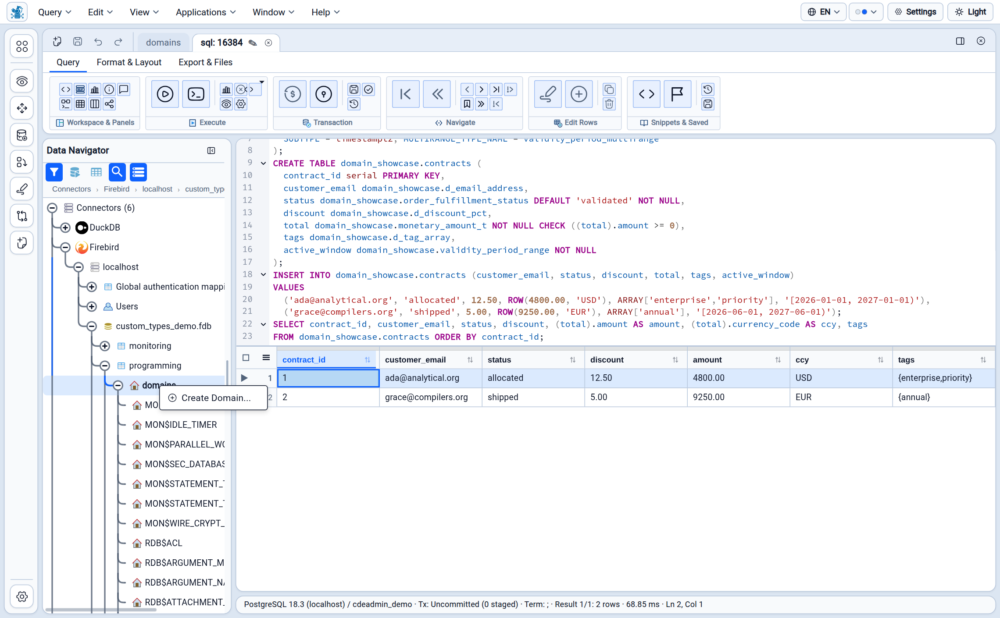
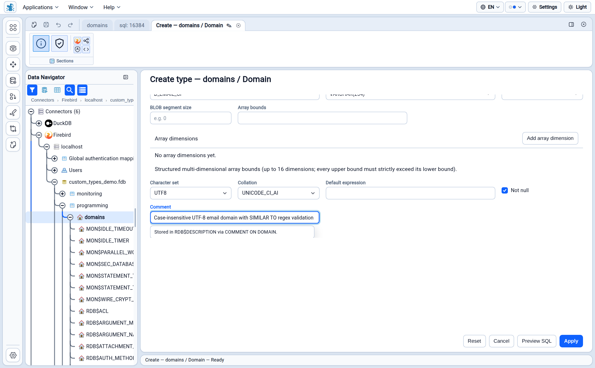
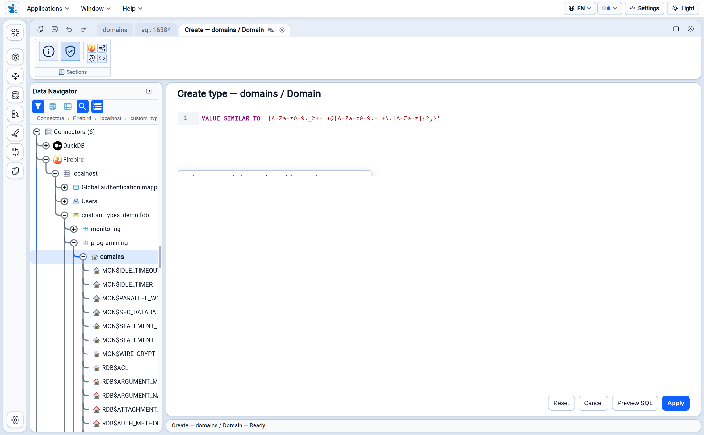
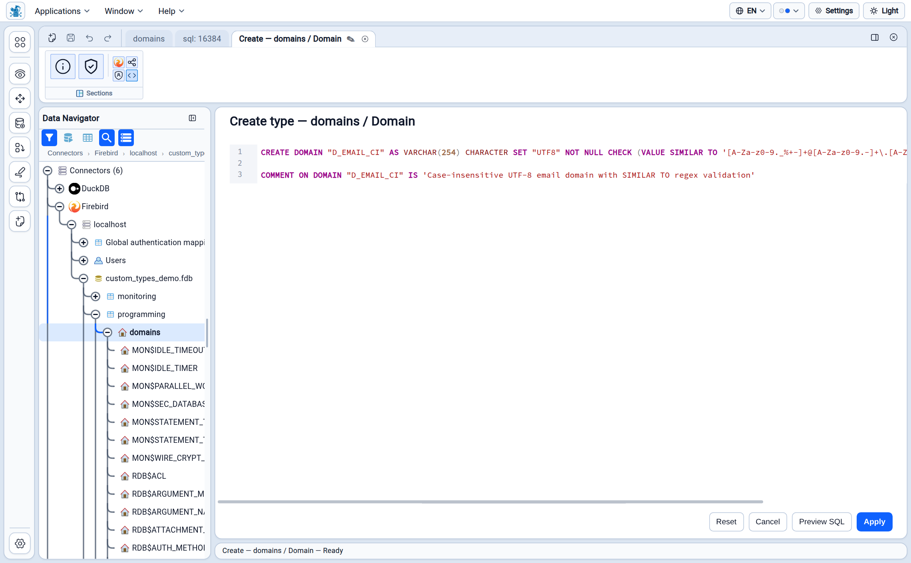
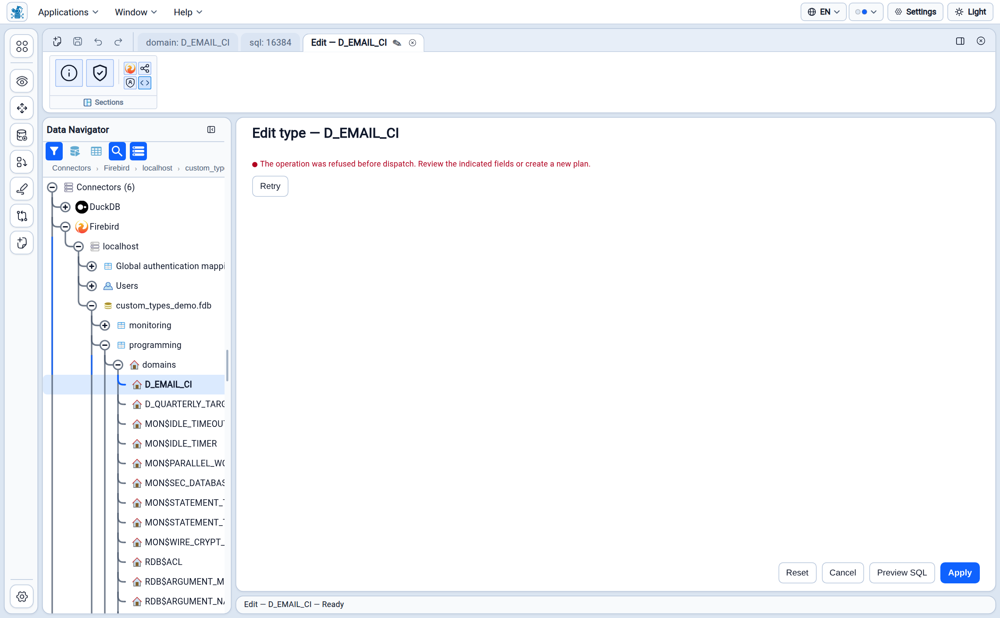

# How to Create Firebird 5 Domains and All Constraint Variations

This guide walks step-by-step through creating, constraining, previewing, applying, and modifying Firebird 5 **Domains** (`CREATE DOMAIN` / `ALTER DOMAIN`) using ScratchRobin's **Firebird Domain Editor (`SR-F-020036`)**.

In Firebird 5, Domains are first-class database-level reusable types (`RDB$FIELDS`) capable of encapsulating scalar data types, extended precision (`INT128`, `DECFLOAT(16|34)`, `NUMERIC(38,s)`), character sets, collations, multi-dimensional array bounds, `BLOB` subtypes/segment sizes, defaults, `NOT NULL`, and `VALUE`-based `CHECK` predicates — referenced across table columns, stored procedure parameters, function return types, and PSQL local variables (`TYPE OF D_EMAIL_CI`).

---

## Domain & Constraint Variations Covered

1. **Character-Set, Case-Insensitive Collated & Regex-Validated Text Domain (`D_EMAIL_CI`)**:
   - `VARCHAR(254) CHARACTER SET UTF8` + `NOT NULL` + `CHECK (VALUE SIMILAR TO '...')` + `COLLATE UNICODE_CI_AI` + `COMMENT ON DOMAIN`
2. **Multi-Dimensional Array Domain (`D_QUARTERLY_TARGETS`)**:
   - `NUMERIC(14,2)[1:4]` (supports 1D `[1:4]` and multi-dimensional `[1:3, 1:2]` Firebird array bounds)
3. **Numeric Default & Bounded Range Domain (`D_TAX_RATE_PCT`)**:
   - `NUMERIC(5,2)` + `DEFAULT 0.00` + `NOT NULL` + `CHECK (VALUE BETWEEN 0.00 AND 100.00)`
4. **Closed-Set Enumeration Domain (`D_PRIORITY_CODE`)**:
   - `VARCHAR(16) CHARACTER SET UTF8` + `DEFAULT 'NORMAL'` + `NOT NULL` + `CHECK (VALUE IN ('LOW', 'NORMAL', 'HIGH', 'CRITICAL'))`
5. **Nullable Pattern Domain (`D_NULLABLE_COUPON`)**:
   - `CHAR(8) CHARACTER SET ASCII` + null-tolerant `CHECK (VALUE IS NULL OR VALUE SIMILAR TO '[A-Z]{3}[0-9]{5}')`
6. **Length-Constrained Text BLOB Domain (`D_AUDIT_NOTES_TEXT`)**:
   - `BLOB SUB_TYPE TEXT SEGMENT SIZE 80 CHARACTER SET UTF8` + `CHECK (VALUE IS NULL OR CHAR_LENGTH(VALUE) <= 16000)`

---

## Step 1: Open Create Domain from Data Navigator

1. Open **Data Navigator**, expand `Firebird -> <server> -> <database.fdb> -> programming -> domains`.
2. Right-click **`domains`** (or right-click `programming` or the `.fdb` database node and choose **`Create -> Domain...`**) and click **`Create Domain...`**.



---

## Step 2: Configure Base Data Type, Character Set, Collation, Default & Nullability

On the **`General`** tab of the Firebird Domain editor (`SR-F-020036`):

1. Set **Name** to `D_EMAIL_CI`.
2. Enter or select **Base data type** = `VARCHAR(254)` from the Firebird 5 type combo box (`SMALLINT`, `INTEGER`, `BIGINT`, `INT128`, `NUMERIC(p,s)`, `DECIMAL(p,s)`, `DECFLOAT(16)`, `DECFLOAT(34)`, `BOOLEAN`, `TIMESTAMP WITH TIME ZONE`, `VARCHAR(n)`, `BLOB SUB_TYPE TEXT SEGMENT SIZE 80`, etc.).
3. Choose **Character set** = `UTF8` (resolved live from `RDB$CHARACTER_SETS`).
4. Choose **Collation** = `UNICODE_CI_AI` (case-insensitive, accent-insensitive Unicode collation resolved live from `RDB$COLLATIONS`).
5. Enable **Not null** (`NOT NULL`), optionally set **Default expression** (without the `DEFAULT` keyword, e.g. `0.00`, `'NORMAL'`, `CURRENT_TIMESTAMP`, or `CURRENT_USER`), and enter a **Comment** (`RDB$DESCRIPTION`).

> [!IMPORTANT]
> Firebird's SQL grammar requires `CHARACTER SET` immediately after the base type (`VARCHAR(254) CHARACTER SET "UTF8"`), whereas `COLLATE` must appear **at the end** of `CREATE DOMAIN` *after* `DEFAULT`, `NOT NULL`, and `CHECK (...)`. ScratchRobin's compiler orders these clauses automatically.



---

## Step 3: Add `CHECK (VALUE ...)` Constraint Expressions

Switch to the **`Constraints`** tab and enter the validation predicate in **Check expression** using Firebird's `VALUE` keyword (you may write either `VALUE ...` or `CHECK (VALUE ...)`):

```sql
VALUE SIMILAR TO '[A-Za-z0-9._%+-]+@[A-Za-z0-9.-]+\.[A-Za-z]{2,}'
```

> [!WARNING]
> **Nullability & `CHECK` Behavior in Firebird**:
> Unlike PostgreSQL (where `CHECK (expr)` passes when `expr` evaluates to `UNKNOWN`), Firebird's `SIMILAR TO` or comparison predicates on a **nullable** domain should explicitly include `VALUE IS NULL OR ...` (for example, `VALUE IS NULL OR VALUE SIMILAR TO '[A-Z]{3}[0-9]{5}'`) whenever `NULL` values are permitted!



---

## Step 4: Preview Native Firebird DDL & Apply

Switch to the **`SQL`** tab to inspect the generated statements:

```sql
CREATE DOMAIN "D_EMAIL_CI" AS VARCHAR(254) CHARACTER SET "UTF8" NOT NULL CHECK (VALUE SIMILAR TO '[A-Za-z0-9._%+-]+@[A-Za-z0-9.-]+\.[A-Za-z]{2,}') COLLATE "UNICODE_CI_AI";
COMMENT ON DOMAIN "D_EMAIL_CI" IS 'Case-insensitive UTF-8 email domain with SIMILAR TO regex validation'
```

Click **`Apply`** to execute the plan inside a native Firebird savepoint/DDL transaction and refresh **Data Navigator**.



---

## Step 5: Create Multi-Dimensional Array & Structured BLOB Domains

1. **Multi-Dimensional Array Domains (`1..16` dimensions, `upper > lower`)**:
   - Open **`Create Domain...`**, set **Base data type** = `NUMERIC(14,2)`, and define dimensions either via the structured **Array dimensions** grid (`Lower bound = 1, Upper bound = 4`; `Lower bound = 1, Upper bound = 2` -> `NUMERIC(14,2)[1:4, 1:2]`) or via the **Array bounds** shorthand (`[1:4]`).
   - In accordance with Firebird 5.0's native array rules, ScratchRobin enforces up to 16 signed 32-bit dimensions and requires every **Upper bound** to strictly exceed its **Lower bound** (rejecting `1:1` single-element bounds and `BLOB` array combinations before execution).
2. **Structured `BLOB` Domains**:
   - Set **Base data type** = `BLOB`, choose **BLOB subtype** = `TEXT` (`1`), `BINARY` (`0`), or a custom signed 16-bit integer subtype, set **BLOB segment size** (for example `80`), and select **Character set** = `UTF8`.

![Creating a Firebird 5 multi-dimensional array domain with [1:4, 1:2] bounds](images/custom-types/fb-05-domain-array-bounds-editor.png)

---

## Step 6: Alter & Rename Existing Firebird Domains (`Edit...`)

Firebird 5 allows a single `CHECK` constraint per domain (`RDB$VALIDATION_SOURCE`) and requires dropping any existing domain constraint before adding a replacement. ScratchRobin automates every `ALTER DOMAIN` clause cleanly:

1. Expand `programming -> domains` in **Data Navigator**, right-click the domain (for example `D_EMAIL_CI`), and click **`Edit...`**.
2. Modify any supported domain property:
   - **Rename**: enter a new identifier in **Rename to** (`ALTER DOMAIN "D_EMAIL_CI" TO "D_EMAIL_PRIMARY"`).
   - **Retype**: update **Base data type** (`ALTER DOMAIN ... TYPE ...`; note Firebird forbids changing `BLOB` or array domains to incompatible storage classes when referenced by table data).
   - **Defaults & Nullability**: set **Default expression** (`SET DEFAULT ...`), check **Drop default** on the **`Engine`** tab (`DROP DEFAULT`), or toggle **Not null** (`SET NOT NULL` / `DROP NOT NULL`).
   - **Atomic `CHECK` Replacement**: on **`Constraints`**, check **Drop existing check constraint** (or simply edit **Check expression** when an existing `CHECK` is present — ScratchRobin automatically prepends `DROP CONSTRAINT`!), optionally assign a **Constraint name** (`CHK_EMAIL_V2`), and enter the updated `VALUE` predicate.
   - **Comments**: update **Comment** or check **Clear comment** (`COMMENT ON DOMAIN "..." IS NULL`).
3. Switch to **`SQL`** to verify the atomic Firebird DDL (`ALTER DOMAIN "D_EMAIL_CI" SET DEFAULT 'noreply@example.org' DROP CONSTRAINT ADD CONSTRAINT "CHK_EMAIL_V2" CHECK (...)`) and click **`Apply`**.



---

## Step 7: Drop Firebird Domains Safely (`Drop...`)

1. Right-click the domain under `programming -> domains` (for example `D_OBSOLETE_CODE`) and click **`Drop...`**.
2. In the modal **Drop Domain Operation Dialog**:
   - Type the exact domain name in **`Type D_OBSOLETE_CODE to confirm`**.
   - Click **`Preview`** to inspect the **Planned Statement Impact** (`remove` / `destructive`) and **Provider plan** (`DROP DOMAIN "D_OBSOLETE_CODE"`).
   - Note: Firebird always enforces dependency checks (`RDB$DEPENDENCIES`) when dropping a domain — if any table column, view, or PSQL routine still references the domain, Firebird aborts the transaction cleanly with a dependency error so live objects cannot be broken accidentally.
3. Click **`Run`** to drop the domain and refresh **Data Navigator**.


---

## Step 8: Verify Live Constraint Enforcement Across Table Columns

Open the **Firebird SQL Editor** (`SQL + Data Split`) to verify range, closed-set, nullable pattern, and text BLOB domains on a live table:


