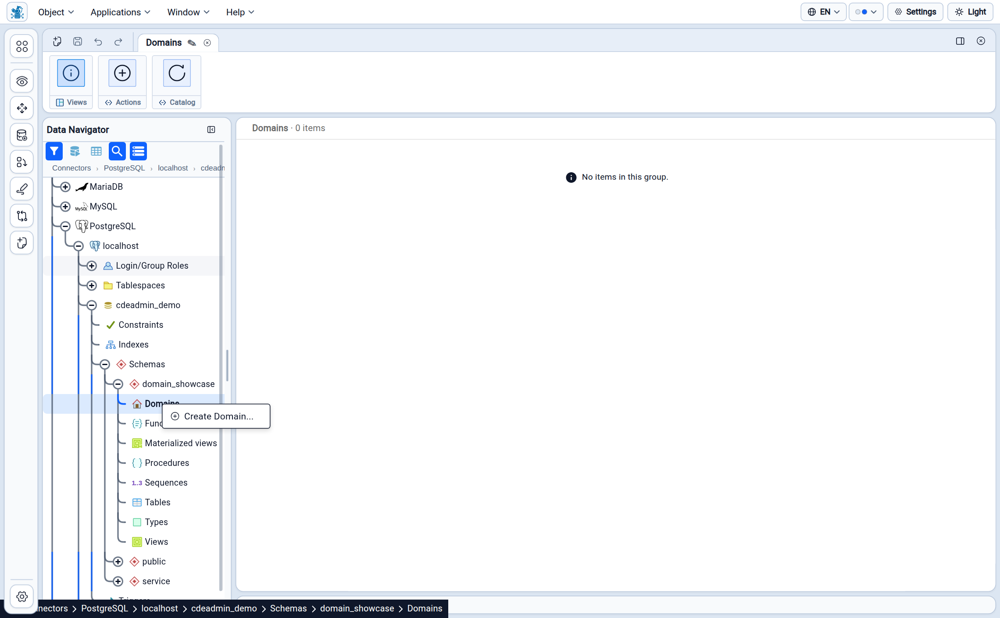
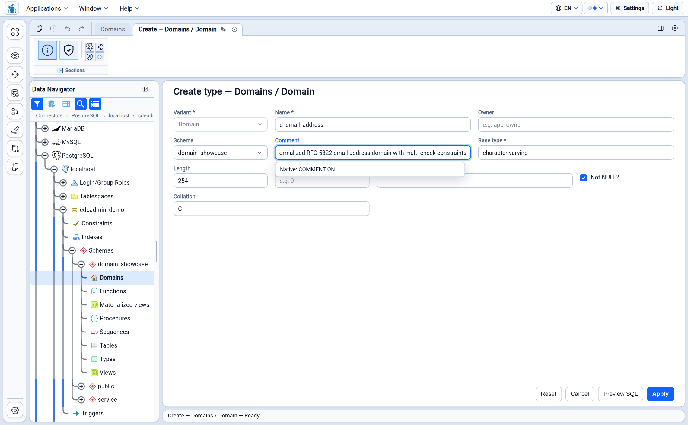
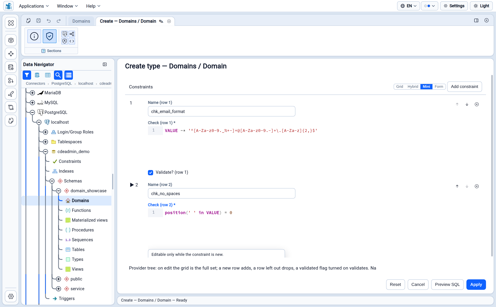
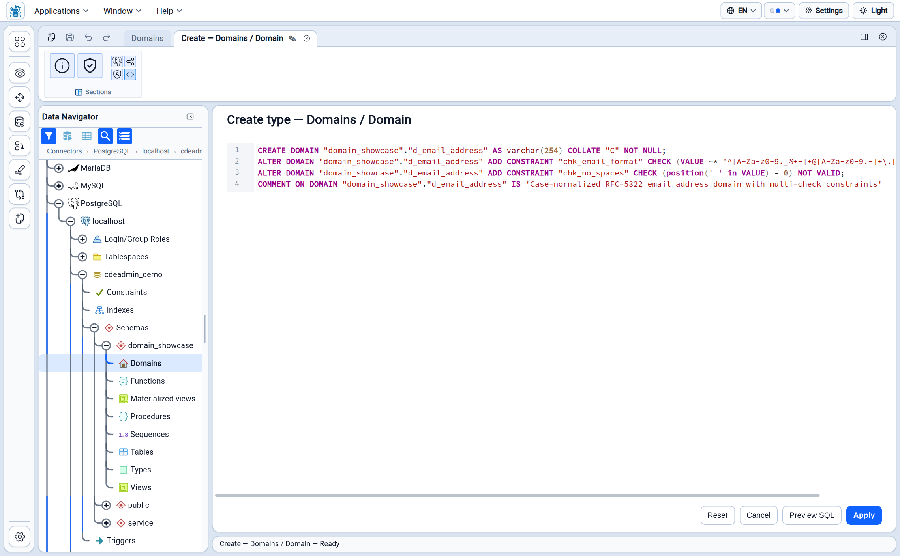
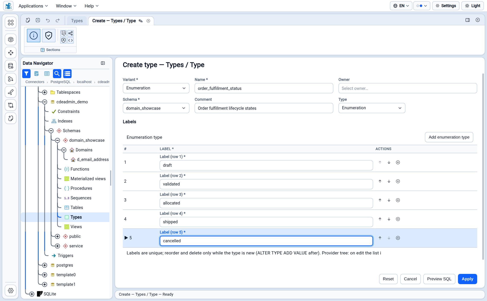
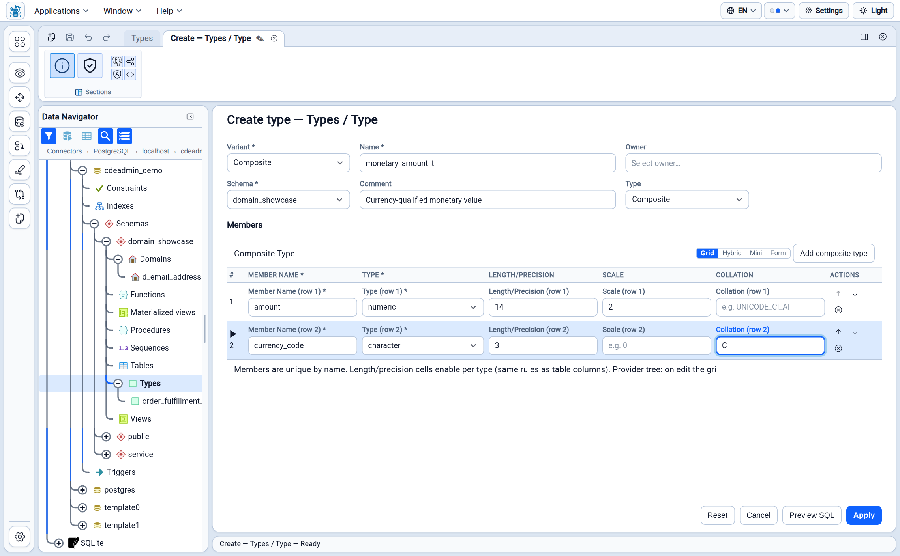
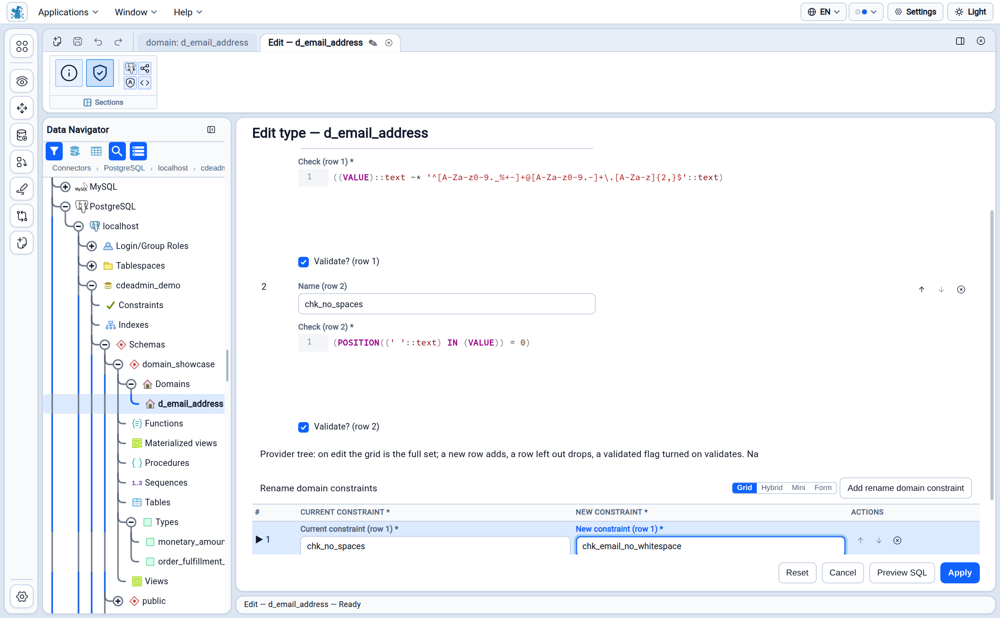
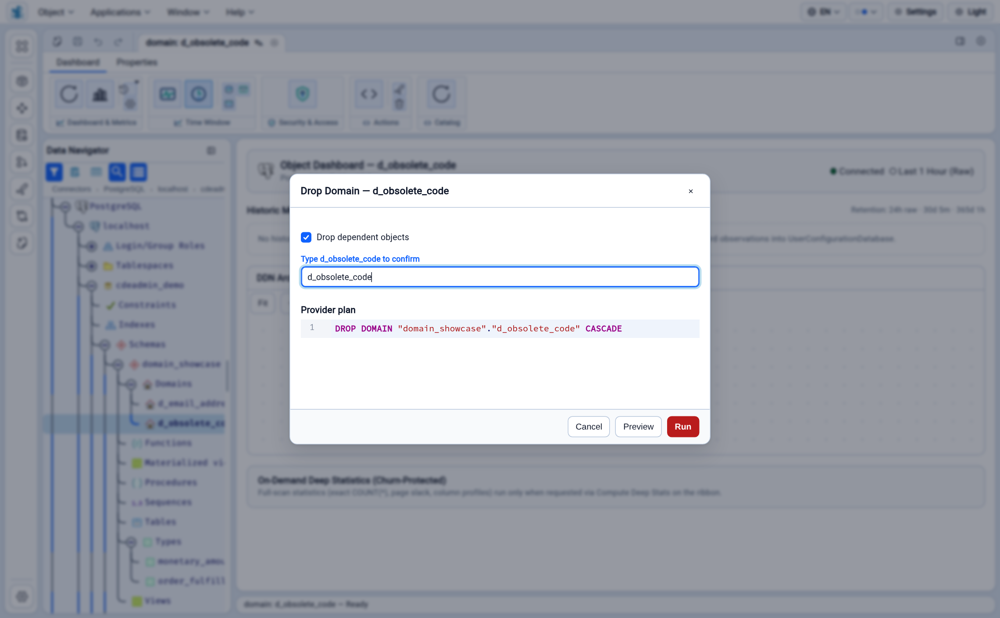
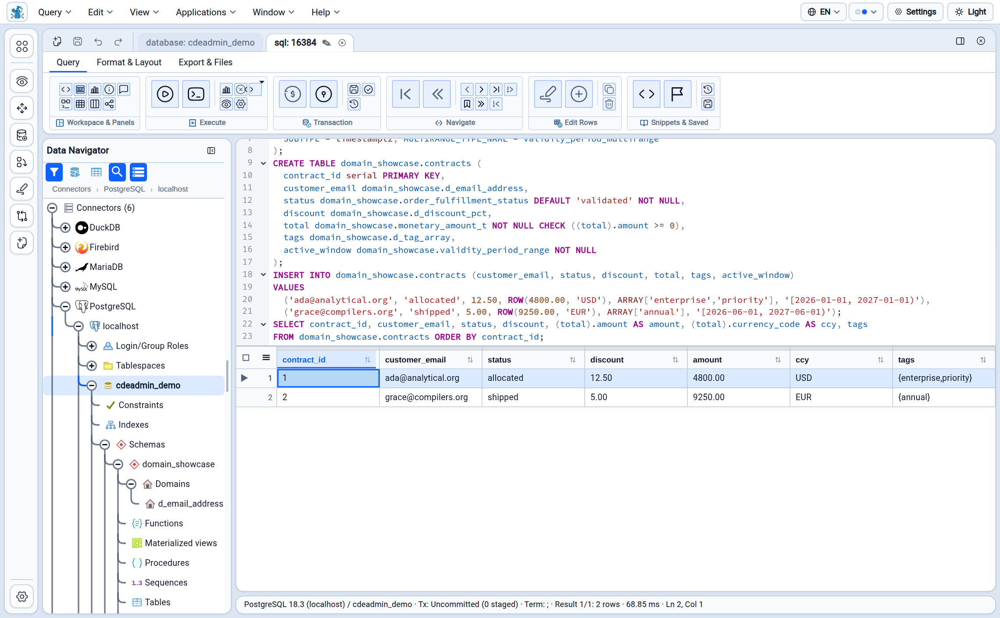

# How to Create PostgreSQL Domains and Custom Types (`ENUM`, `COMPOSITE`, `RANGE`)

This guide walks step-by-step through creating, constraining, previewing, applying, and validating PostgreSQL **Domains** (`CREATE DOMAIN`) and **Custom Types** (`CREATE TYPE` — Enumeration, Composite, Range/Multirange, External, and Shell) using ScratchRobin's unified **Type & Domain Editor (`SR-F-020068`)**.

---

## Constraint & Type Variations Covered

1. **Multi-Constraint Collation-Aware Text Domain (`d_email_address`)**:
   - Base type `character varying(254)` + `COLLATE "C"` + `NOT NULL`
   - Validated named regex `CHECK` constraint (`chk_email_format`)
   - Unvalidated (`NOT VALID`) named `CHECK` constraint (`chk_no_spaces`) followed by online `ALTER DOMAIN ... VALIDATE CONSTRAINT`
2. **Numeric Default & Dual-Bound Range Domain (`d_discount_pct`)**:
   - `numeric(5,2)` + `DEFAULT 0.00` + `NOT NULL` + `chk_pct_min` (`VALUE >= 0`) + `chk_pct_max` (`VALUE <= 100`)
3. **Bounded Non-Null Element Array Domain (`d_tag_array`)**:
   - `text[]` + `DEFAULT '{}'::text[]` + `NOT NULL` + `CHECK (cardinality(VALUE) <= 5 AND array_position(VALUE, NULL) IS NULL)`
4. **Enumerated Custom Type (`order_fulfillment_status`)**:
   - Ordered closed-set labels (`draft`, `validated`, `allocated`, `shipped`, `cancelled`)
5. **Composite Custom Type (`monetary_amount_t`)**:
   - Multi-attribute structured record (`amount numeric(14,2)`, `currency_code character(3) COLLATE "C"`)
6. **Range & Companion Multirange Custom Type (`validity_period_range`)**:
   - `AS RANGE (SUBTYPE = timestamptz, MULTIRANGE_TYPE_NAME = validity_period_multirange)`

---

## Step 1: Open Create Domain or Create Type from Data Navigator

1. Open **Data Navigator**, expand `PostgreSQL -> <server> -> <database> -> Schemas -> <schema>` (for example, `domain_showcase`).
2. Right-click **`Domains`** (or right-click the `<schema>` node directly and choose **`Create -> Domain...`**) and click **`Create Domain...`**.
   - ScratchRobin automatically locks `Variant` to **`Domain`** and pre-populates **`Schema`** with your selected schema (`domain_showcase`).



---

## Step 2: Configure Domain Base Type, Length, Collation, Default & Nullability

On the **`General`** tab of the Domain editor (`SR-F-020068`):

1. Set **Name** to `d_email_address`.
2. Confirm **Schema** is `domain_showcase` (and optionally choose an explicit role in **Owner**; leaving **Owner** blank defaults to `CURRENT_USER`).
3. Select **Base type** = `character varying` and set **Length** = `254` (because **Base type** is a searchable free-entry `ComboBox`, you can either choose any discovered catalog type or type array/parameterized base types directly such as `text[]`, `integer[]`, or `numeric(14,2)`).
4. Enter or select **Collation** = `C` (a searchable free-entry `ComboBox` supporting both built-in `pg_catalog` collations such as `C`, `POSIX`, and `ucs_basic` as well as custom ICU collations discovered in your schemas).
5. Enable **Not NULL?** (`NOT NULL`).
6. Enter a descriptive **Comment** (`COMMENT ON DOMAIN`).



---

## Step 3: Add Multiple Named `CHECK` Constraints (Including Deferred `NOT VALID`)

Switch to the **`Constraints`** tab:

1. Click **`+ Add row`** in the **Constraints** grid (`RecordGrid` supports Standard Grid, Hybrid, Mini-Form, and Full-Form views).
2. Add as many named `CHECK` constraints as needed — PostgreSQL evaluates all domain `CHECK` expressions using the special `VALUE` identifier:
   - Row 1:
     - **Name**: `chk_email_format`
     - **Check**: `VALUE ~* '^[A-Za-z0-9._%+-]+@[A-Za-z0-9.-]+\.[A-Za-z]{2,}$'`
     - **Validated**: **Checked** (enforced immediately for all rows)
   - Row 2:
     - **Name**: `chk_no_spaces`
     - **Check**: `position(' ' in VALUE) = 0`
     - **Validated**: **Unchecked** (`NOT VALID` — emits `ALTER DOMAIN ... ADD CONSTRAINT "chk_no_spaces" CHECK (...) NOT VALID`, allowing zero-downtime constraint rollout on populated databases before running `VALIDATE CONSTRAINT`!)

> [!TIP]
> When editing an existing domain or type later (`Right-click -> Edit...`):
> - Checking **Validate?** on an unvalidated constraint compiles `ALTER DOMAIN ... VALIDATE CONSTRAINT "..."`;
> - Removing a row compiles `ALTER DOMAIN ... DROP CONSTRAINT "..."`;
> - Adding rows to **Rename domain constraints** (`Constraints` tab), **Rename enumeration values** (`General` tab on `ENUM` types), or **Rename composite attributes** (`General` tab on `COMPOSITE` types) compiles `ALTER DOMAIN ... RENAME CONSTRAINT`, `ALTER TYPE ... RENAME VALUE`, and `ALTER TYPE ... RENAME ATTRIBUTE` respectively;
> - Changing **Schema** or **Owner** compiles `SET SCHEMA` and `OWNER TO`.



---

## Step 4: Review the Generated Native PostgreSQL DDL & Apply

Switch to the **`SQL`** tab (or click **Preview SQL**) to inspect the exact multi-statement native plan before execution:

```sql
CREATE DOMAIN "domain_showcase"."d_email_address" AS character varying(254) COLLATE "C" NOT NULL;
ALTER DOMAIN "domain_showcase"."d_email_address" ADD CONSTRAINT "chk_email_format" CHECK (VALUE ~* '^[A-Za-z0-9._%+-]+@[A-Za-z0-9.-]+\.[A-Za-z]{2,}$');
ALTER DOMAIN "domain_showcase"."d_email_address" ADD CONSTRAINT "chk_no_spaces" CHECK (position(' ' in VALUE) = 0) NOT VALID;
COMMENT ON DOMAIN "domain_showcase"."d_email_address" IS 'Case-normalized RFC-5322 email address domain with multi-check constraints'
```

Click **`Apply`** (and **`Confirm and apply`** if prompted) to create the domain live and refresh **Data Navigator**.



---

## Step 5: Create Custom Enumeration (`ENUM`) Types

1. In **Data Navigator**, right-click **`Types`** under your schema (or `<schema> -> Create -> Type...`) and click **`Create Type...`**.
2. Set **Variant** to **`Enumeration`** (notice **Type** automatically synchronizes to `Enumeration`).
3. Set **Name** to `order_fulfillment_status` and confirm **Schema** is `domain_showcase`.
4. Add ordered labels in the **Labels** grid (`draft`, `validated`, `allocated`, `shipped`, `cancelled`) — drag or reorder rows as needed before creation, then click **`Apply`**.
   - Later edits to an existing `ENUM` type via **`Edit...`** automatically diff newly added labels into `ALTER TYPE ... ADD VALUE '...' AFTER '...'` statements!



---

## Step 6: Create Composite (`AS (...)`) and Range (`AS RANGE`) Custom Types

1. Right-click **`Types -> Create Type...`** and choose **Variant = `Composite`**.
2. Set **Name** = `monetary_amount_t`, **Schema** = `domain_showcase`, and add attributes in the **Members** grid:
   - `amount` — Type `numeric`, Length `14`, Precision `2`
   - `currency_code` — Type `character`, Length `3`, Collation `C`
3. Click **`Apply`**.
4. To create a **Range + Multirange** type (`Variant = Range`), pick **Subtype** (e.g., `timestamp with time zone` or `numeric`), optional **Subtype operator class**, **Canonical function** / **Subtype diff function**, and **Multirange type name** (e.g., `validity_period_multirange` on PostgreSQL 14+).



---

## Step 7: Alter Existing PostgreSQL Domains & Custom Types (`Edit...`)

To modify any existing PostgreSQL domain or custom type in place:

1. Expand `Schemas -> <schema> -> Domains` (or `Types`) in **Data Navigator**, right-click the object (for example `d_email_address`), and click **`Edit...`**.
2. ScratchRobin loads the live catalog state from `pg_type`, `pg_constraint`, `pg_enum`, `pg_attribute`, and `pg_range`, locking fields that PostgreSQL cannot alter after creation (such as a domain's `Base type` or an existing constraint's `Check` expression) while unlocking alter-specific grids and actions:
   - **Domain Alterations**:
     - Rename the domain (**Name** -> `ALTER DOMAIN ... RENAME TO ...`), move schemas (**Schema** -> `SET SCHEMA`), or transfer ownership (**Owner** -> `OWNER TO`);
     - Set or clear **Default** (`SET DEFAULT` / `DROP DEFAULT`) and toggle **Not NULL?** (`SET NOT NULL` / `DROP NOT NULL`);
     - On **`Constraints`**, check **Validate?** on an unvalidated constraint (`ALTER DOMAIN ... VALIDATE CONSTRAINT "chk_no_spaces"`), remove a row to emit `DROP CONSTRAINT`, add new `CHECK` rows (`ADD CONSTRAINT ...`), or populate **Rename domain constraints** (`ALTER DOMAIN ... RENAME CONSTRAINT "chk_no_spaces" TO "chk_email_no_whitespace"`);
     - Manage `GRANT USAGE` / `REVOKE` privileges and `SECURITY LABEL` entries on **`Security`**.
   - **Enum Alterations (`Edit...` on an `ENUM` type)**:
     - Append or insert new enum labels (`ALTER TYPE ... ADD VALUE '...' AFTER '...'`) in **Labels**, or rename existing labels in **Rename enumeration values** (`ALTER TYPE ... RENAME VALUE '...' TO '...'`).
   - **Composite Alterations (`Edit...` on a `COMPOSITE` type)**:
     - Add, drop, or retype/re-collate attributes in **Members** (`ADD ATTRIBUTE`, `DROP ATTRIBUTE`, `ALTER ATTRIBUTE ... SET DATA TYPE ... COLLATE ...`), or rename attributes in **Rename composite attributes** (`ALTER TYPE ... RENAME ATTRIBUTE '...' TO '...'`).
3. Review the ordered `ALTER` statements on the **`SQL`** tab and click **`Apply`**.



---

## Step 8: Drop PostgreSQL Domains & Custom Types Safely (`Drop...`)

1. Right-click the domain or custom type in **Data Navigator** (for example `d_obsolete_code`) and click **`Drop...`**.
2. ScratchRobin opens the modal **Drop Operation Dialog**:
   - Toggle **Drop dependent objects** (`CASCADE`) when dependent columns, views, or functions should be dropped with the domain/type; leave unchecked (`RESTRICT`) so PostgreSQL blocks the drop if any object still depends on it.
   - Enter the exact object name in **`Type <name> to confirm`** (destructive safety gate).
   - Click **`Preview`** to inspect the **Planned Statement Impact** diff table (`remove` / `destructive` badge) and exact **Provider plan** SQL (`DROP DOMAIN "domain_showcase"."d_obsolete_code" CASCADE` or `DROP TYPE ...`).
3. Click **`Run`** to execute the drop and automatically refresh **Data Navigator**.



---

## Step 9: Verify All Constrained Domain & Custom Type Variations Live

Open **Query Tool** (`SQL + Data Split`) on the database and execute a verification script exercising numeric range domains, array cardinality domains, composite field checks (`(total).amount >= 0`), enum defaults, and `tstzrange` + `multirange` values:


