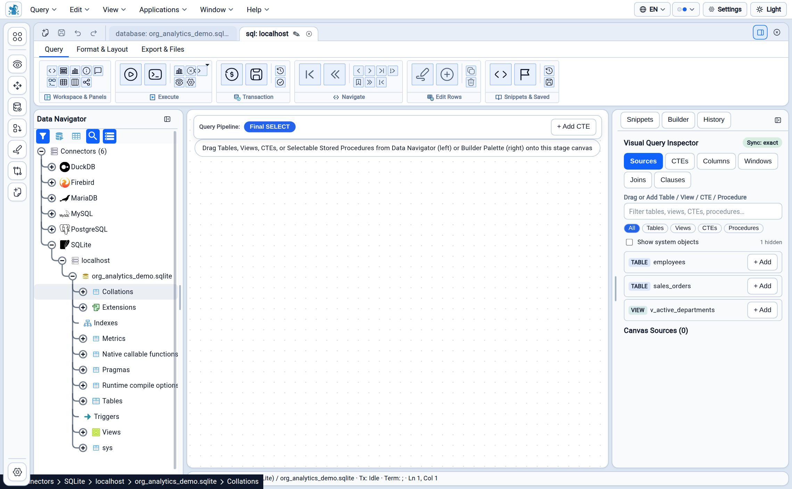
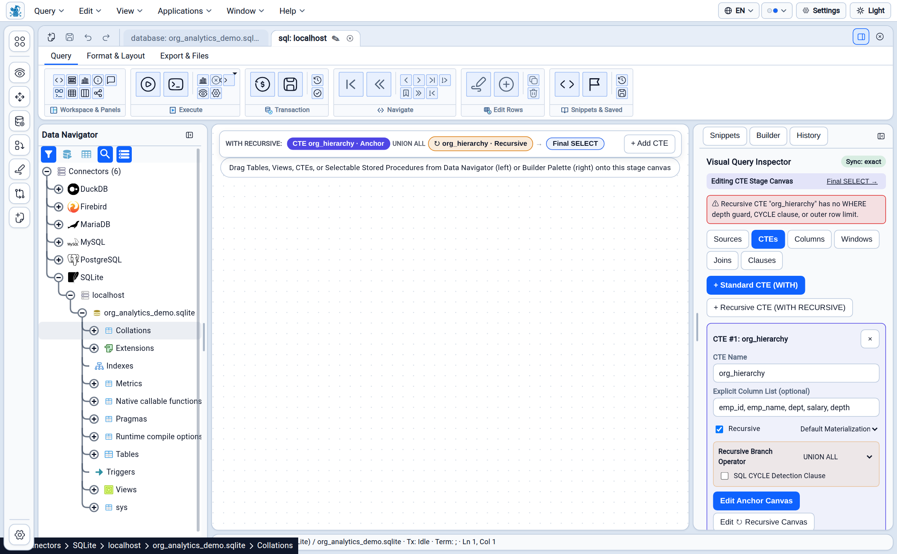
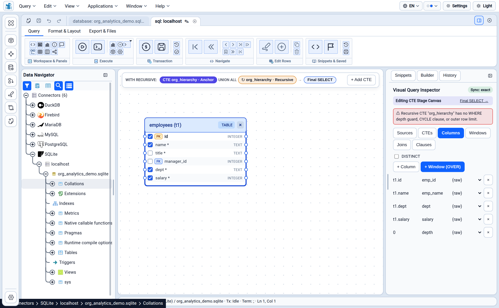
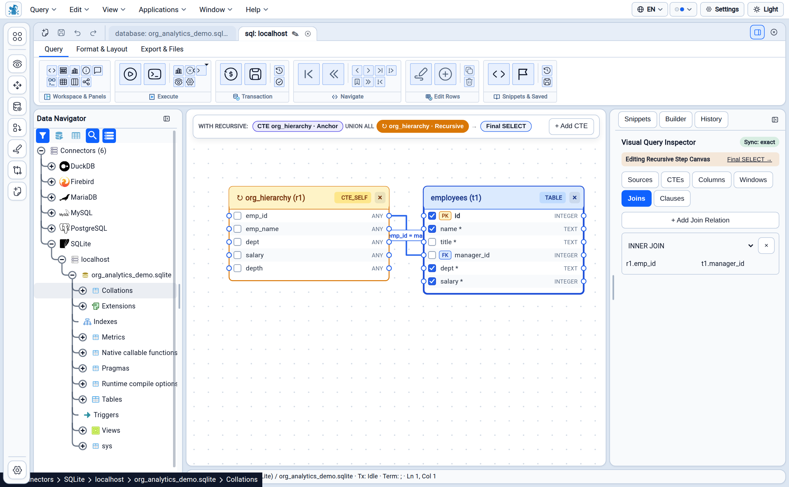
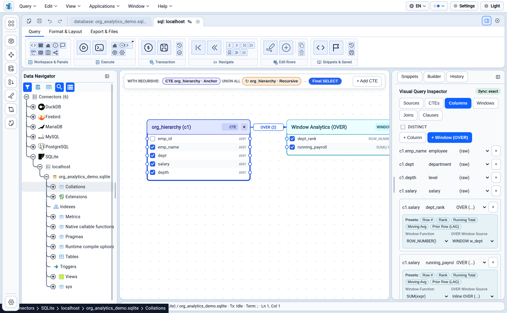
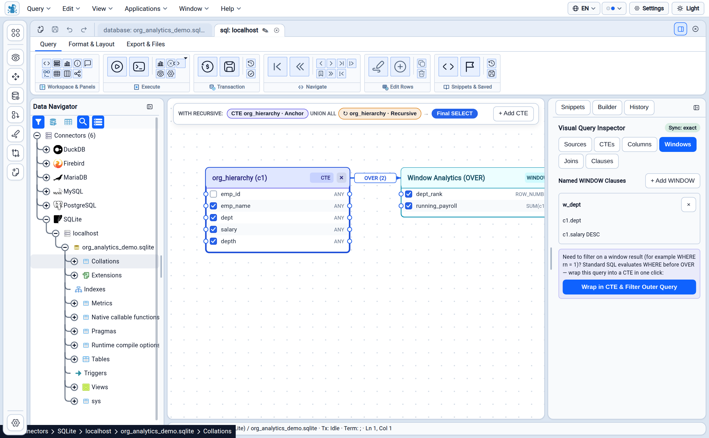
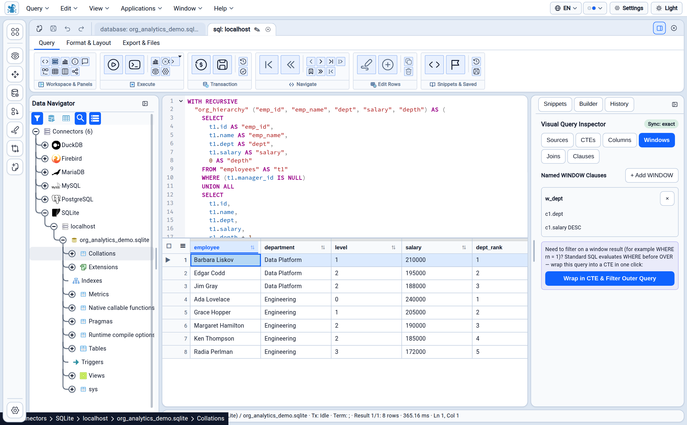
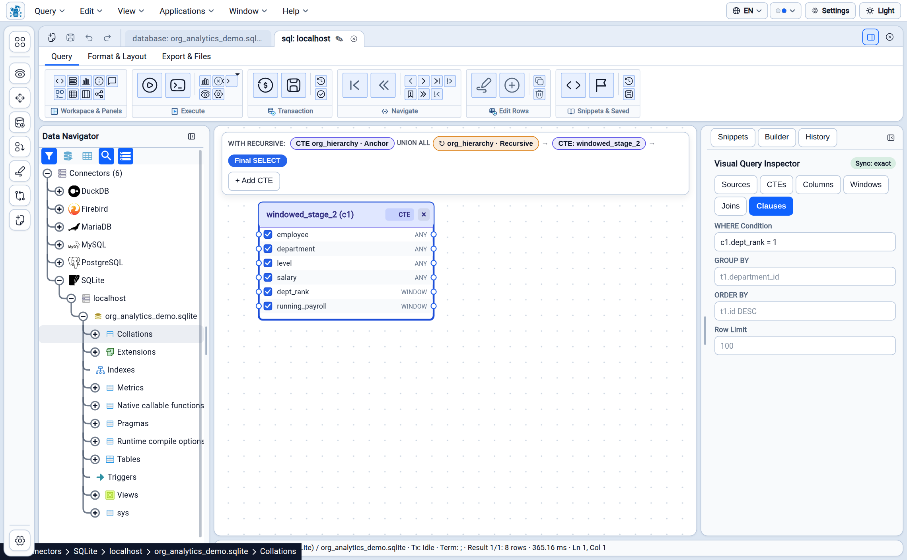

# How to Build CTE, Recursive CTE, and Window Queries Using the Visual Builders

This guide walks step-by-step through authoring staged Common Table Expressions (`WITH` and `WITH RECURSIVE`) and SQL Window Analytics (`OVER (...)`, `PARTITION BY`, `ORDER BY`, `ROWS` / `RANGE` / `GROUPS` frames, and reusable `WINDOW` clauses) in ScratchRobin's Visual Query Builders.

---

## Overview: ScratchRobin's Two Visual Query Builder Surfaces

ScratchRobin provides two complementary visual query authoring surfaces:

1. **SQL Studio Visual Query Builder (DDN Canvas)** (`View -> Visual Query Builder (DDN)` inside any SQL Editor tab):
   - Full interactive Diagram-Design-Notation (`DDN`) canvas with a multi-stage **Query Pipeline** bar across the top and a **Visual Query Inspector** on the right (`Sources · CTEs · Columns · Windows · Joins · Clauses`).
   - Supports multi-stage `WITH` / `WITH RECURSIVE` CTEs, `[↻ SELF]` recursive self-joins, `Window Analytics (OVER)` cards, named `WINDOW` clauses, 1-click post-window CTE wrapping, and live bidirectional synchronization (`Sync: exact`) with the dialect SQL editor.
2. **Form-Guided Visual SQL Builder Dialog** (**Build a query** action on database/table nodes and BI Question drafting):
   - Guided clause-by-clause builder (`FROM`, `JOIN`, `SELECT`, `WHERE`, `GROUP BY`, `HAVING`, `ORDER BY`, `LIMIT` / `ROWS`) paired with a live DDN query-flow diagram preview and direct hand-off into SQL Studio or BI Questions.

Both surfaces hide engine/internal system catalogs by default and offer an explicit **Show system objects** checkbox whenever you want to inspect catalog tables or views (`pg_catalog.*`, `RDB$*` / `MON$*` / `SEC$*`, `information_schema.*`, `sqlite_*`, `duckdb_*`).

---

## Step 1: Open the Visual Query Builder & Control System Object Visibility

1. Open **Data Navigator** from the left rail, expand your target connector and database (for example, `SQLite -> localhost -> org_analytics_demo.sqlite`), right-click the database, and choose **Open SQL editor...**.
2. Switch to the visual canvas from the top menu via **View -> Visual Query Builder (DDN)** (or the **Workspace & Panels** ribbon group).
3. In the right-hand **Visual Query Inspector -> Sources** tab:
   - Notice **Show system objects** is **unchecked by default**, keeping internal catalog relations hidden (indicated by the subtle `1 hidden` badge) so your palette focuses cleanly on application tables, views, CTEs, and selectable procedures.
   - Check **Show system objects** at any time when you want to build metadata/diagnostic queries against engine system views (system entries appear with a `SYS` badge).



---

## Step 2: Create a `WITH` or `WITH RECURSIVE` CTE Stage

Suppose we want to traverse an organizational hierarchy (`employees.id` <- `employees.manager_id`) to compute every employee's reporting `depth`, and then rank salaries and compute running payroll totals inside each department.

1. Click **`+ Add CTE`** on the top **Query Pipeline** bar, or open the **`CTEs`** tab in the **Visual Query Inspector**.
2. Choose either:
   - **`+ Standard CTE (WITH)`** for staged aggregations, deduplication, or readable multi-step pipelines, or
   - **`+ Recursive CTE (WITH RECURSIVE)`** for hierarchical trees, bill-of-materials graphs, or series generation.
3. In the CTE card:
   - Set **CTE Name** to `org_hierarchy`.
   - Set **Explicit Column List** to `emp_id, emp_name, dept, salary, depth` (recommended for recursive CTEs and required on engines such as Firebird 5 when column names are referenced by the recursive step).
   - Optionally select **Materialization** (`MATERIALIZED` / `NOT MATERIALIZED` on PostgreSQL and SQLite 3.35+) or enable **SQL CYCLE Detection Clause** (`CYCLE emp_id SET is_cycle USING traversal_path` on PostgreSQL / standard SQL engines).

Notice two immediate visual aids:
- The **Query Pipeline** bar at the top expands into clickable stages:
  `WITH RECURSIVE: [CTE org_hierarchy · Anchor] UNION ALL [↻ org_hierarchy · Recursive] -> [Final SELECT]`.
- A red safety banner warns that `org_hierarchy` currently has no `WHERE` depth guard, `CYCLE` clause, or outer row limit — preventing accidental runaway recursion before execution.



---

## Step 3: Build the Recursive Anchor Stage (Base Case)

With **`CTE org_hierarchy · Anchor`** active in the **Query Pipeline** bar:

1. Open **`Sources`** and click **`+ Add`** next to `employees` (or drag `employees` from **Data Navigator** onto the canvas). It lands on the stage canvas as `employees (t1)`.
2. Open **`Columns`** and define the five anchor output columns matching `org_hierarchy (emp_id, emp_name, dept, salary, depth)`:
   - `t1.id` -> alias `emp_id`
   - `t1.name` -> alias `emp_name`
   - `t1.dept` -> alias `dept`
   - `t1.salary` -> alias `salary`
   - `0` -> alias `depth` (seed level `0` for root executives)
3. Open **`Clauses`** and enter the root condition in **WHERE Condition**:
   ```sql
   t1.manager_id IS NULL
   ```



---

## Step 4: Build the Recursive Step (`↻` Self-Reference Join & Termination Guard)

1. Click the amber **`↻ org_hierarchy · Recursive`** pill in the **Query Pipeline** bar (or click **Edit ↻ Recursive Canvas** inside the `CTEs` tab).
2. Notice the canvas automatically pre-populates an amber **`↻ org_hierarchy (r1)`** (`CTE_SELF`) card exposing the output columns inferred from your CTE (`emp_id`, `emp_name`, `dept`, `salary`, `depth`).
3. Open **`Sources`** and click **`+ Add`** next to `employees` to place `employees (t1)` alongside `↻ org_hierarchy (r1)`.
4. Connect `r1.emp_id` to `t1.manager_id` either by dragging directly from the `emp_id` port on `↻ org_hierarchy (r1)` to `manager_id` on `employees (t1)`, or via **`Joins -> + Add Join Relation`** (`INNER JOIN`: `r1.emp_id = t1.manager_id`).
5. Open **`Columns`** and project the inductive columns in matching order:
   - `t1.id`
   - `t1.name`
   - `t1.dept`
   - `t1.salary`
   - `r1.depth + 1`
6. Open **`Clauses`** and add a recursion depth guard in **WHERE Condition**:
   ```sql
   r1.depth < 6
   ```
   As soon as the termination guard is added, the red runaway-recursion warning banner clears automatically.



---

## Step 5: Query the CTE & Add Window Functions (`OVER`) on `Final SELECT`

Now click **`Final SELECT`** in the **Query Pipeline** bar to consume `org_hierarchy` and layer analytical window calculations on top of it:

1. Open **`Sources`**. Notice `org_hierarchy` now appears as a **`CTE`** source in your palette! Click **`+ Add`** to place **`org_hierarchy (c1)`** on the `Final SELECT` canvas.
2. *(Optional — Reusable Named Window)* Open **`Windows`**, click **`+ Add WINDOW`**, and define:
   - **Window Name**: `w_dept`
   - **PARTITION BY**: `c1.dept`
   - **ORDER BY**: `c1.salary DESC`
3. Open **`Columns`**:
   - Add standard output columns (`c1.emp_name` -> `employee`, `c1.dept` -> `department`, `c1.depth` -> `level`, `c1.salary` -> `salary`).
   - Click **`+ Window (OVER)`** to add window projections (or switch any existing column's function dropdown to **`OVER (...)`**).
4. Configure each window column using either the **1-click Presets** (`Row #`, `Rank`, `Running Total`, `Moving Avg`, `Prior Row (LAG)`) or full custom controls:
   - **`dept_rank`**: choose **`ROW_NUMBER()`** and set **OVER Window Source** to **`WINDOW w_dept`** (compiles to `ROW_NUMBER() OVER "w_dept" AS "dept_rank"`).
   - **`running_payroll`**: click the **`Running Total`** preset on `c1.salary`, set **PARTITION BY** to `c1.dept`, **Window ORDER BY** to `c1.salary DESC`, and keep the frame `ROWS` from `UNBOUNDED PRECEDING` to `CURRENT ROW` (compiles to `SUM(c1.salary) OVER (PARTITION BY c1.dept ORDER BY c1.salary DESC ROWS BETWEEN UNBOUNDED PRECEDING AND CURRENT ROW) AS "running_payroll"`).

On the canvas, ScratchRobin automatically renders a linked cyan **`Window Analytics (OVER)`** node wired to the contributing source table/CTE (`OVER (2)`), giving immediate visual clarity whenever a query mixes row-level columns and window partitions.



### Named `WINDOW` Clauses & Post-Window Filtering Helper

Opening the **`Windows`** inspector tab displays all reusable `WINDOW` definitions for the current stage, plus a dedicated 1-click helper for filtering on window results:



---

## Step 6: Review Dialect SQL & Execute Live Results (`SQL + Data Split`)

1. Switch to **View -> SQL + Data Split** to inspect the synchronized SQL generated by the Visual Builder alongside the result grid.
2. Click **Execute Statement (`F9`)** (the **`▶`** button in the **Execute** ribbon section):

```sql
WITH RECURSIVE
  "org_hierarchy" ("emp_id", "emp_name", "dept", "salary", "depth") AS (
    SELECT
      t1.id AS "emp_id",
      t1.name AS "emp_name",
      t1.dept AS "dept",
      t1.salary AS "salary",
      0 AS "depth"
    FROM "employees" AS "t1"
    WHERE (t1.manager_id IS NULL)
    UNION ALL
    SELECT
      t1.id,
      t1.name,
      t1.dept,
      t1.salary,
      r1.depth + 1
    FROM "org_hierarchy" AS "r1"
    INNER JOIN "employees" AS "t1" ON r1.emp_id = t1.manager_id
    WHERE (r1.depth < 6)
  )
SELECT
  c1.emp_name AS "employee",
  c1.dept AS "department",
  c1.depth AS "level",
  c1.salary AS "salary",
  ROW_NUMBER() OVER "w_dept" AS "dept_rank",
  SUM(c1.salary) OVER (
    PARTITION BY c1.dept
    ORDER BY c1.salary DESC
    ROWS BETWEEN UNBOUNDED PRECEDING AND CURRENT ROW
  ) AS "running_payroll"
FROM "org_hierarchy" AS "c1"
WINDOW "w_dept" AS (PARTITION BY c1.dept ORDER BY c1.salary DESC)
```



---

## Step 7: Filter on a Window Result (`WHERE dept_rank = 1`) in One Click

Standard SQL evaluates `WHERE` *before* `OVER (...)` window functions (and engines other than DuckDB do not support `QUALIFY`). Whenever you want only the top-ranked row per partition (`dept_rank = 1`):

1. Return to **View -> Visual Query Builder (DDN)** -> **`Windows`** tab.
2. Click **`Wrap in CTE & Filter Outer Query`**.
3. ScratchRobin promotes your current `Final SELECT` (including its `OVER` projections and `WINDOW` definitions) into a new CTE stage (`windowed_stage_2`) and creates a clean outer `Final SELECT` referencing `windowed_stage_2 (c1)` with its `WINDOW`-typed columns ready to filter.
4. Open **`Clauses`** on the new `Final SELECT` and enter:
   ```sql
   c1.dept_rank = 1
   ```



---

## Multi-Engine Dialect Reference

ScratchRobin automatically adapts identifier quoting, row-limiting syntax, and recursive keywords for the active connection's database engine:

| Engine | Recursive CTE Syntax | Window Frame & Named `WINDOW` Support | Row Limit Clause Emitted |
| :--- | :--- | :--- | :--- |
| **PostgreSQL** | `WITH RECURSIVE` + `MATERIALIZED` + `CYCLE` | `ROWS`, `RANGE`, `GROUPS`, Named `WINDOW` | `LIMIT n` |
| **Firebird 5.0+** | `WITH RECURSIVE` (explicit CTE column list recommended) | `ROWS`, `RANGE`, Named `WINDOW` | `ROWS n` |
| **SQLite 3.35+** | `WITH RECURSIVE` + `MATERIALIZED` | `ROWS`, `RANGE`, `GROUPS`, Named `WINDOW` | `LIMIT n` |
| **DuckDB** | `WITH RECURSIVE` + `MATERIALIZED` | `ROWS`, `RANGE`, `GROUPS`, Named `WINDOW` | `LIMIT n` |
| **MySQL 8.0+** | `WITH RECURSIVE` | `ROWS`, `RANGE`, Named `WINDOW` | `LIMIT n` |
| **MariaDB 10.2+** | `WITH RECURSIVE` | `ROWS`, `RANGE` (inline `OVER (...)` recommended when targeting MariaDB builds without `WINDOW w AS`) | `LIMIT n` |
